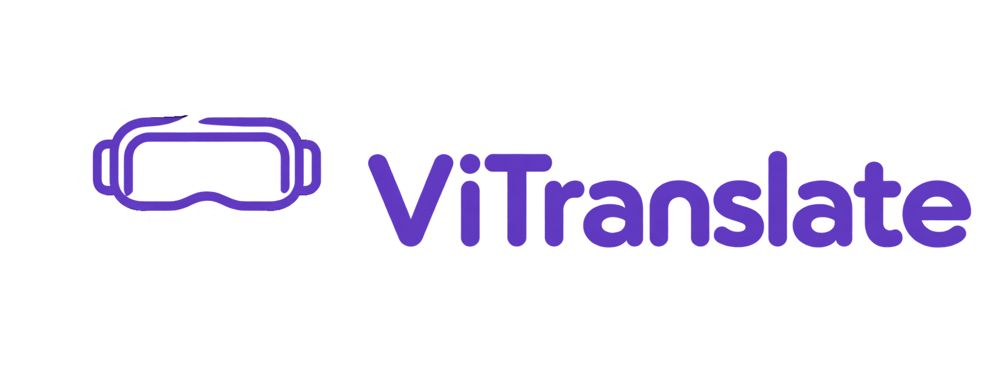

# ViTranslate

Бесплатный локальный переводчик и помощник ввода для Windows 11 (x64).

**[Скачать portable-версию 1.9.0](https://github.com/vikaquest/ViTranslate/releases/tag/v1.9.0)**

## Открытый модуль перевода

Опубликован **[исходный модуль локального перевода](TRANSLATION_WORKER.md)**: воркер Python, зависимости, установщик моделей RU ↔ EN, инструкция и примеры запуска. Воркер и файлы запуска находятся прямо в корне репозитория; [worker.py](worker.py) можно изучить и запустить отдельно от ViTranslate. Опубликованный собственный код воркера и вспомогательных скриптов доступен под MIT; модели и библиотеки имеют собственные условия.

ViTranslate остаётся приложением с закрытым интерфейсом и интеграцией с полями ввода. Открытый модуль объясняет выполнение перевода, но не является полными исходниками приложения и не позволяет проверить поведение всего EXE.

## Что нового в 1.9.0

- **Подсказки больше не перекрывают каретку.** В «Вид» добавлены режимы «Исчезает», «Обтекает текст» и «Выключено». Обтекание смещает окно выше или ниже каретки и возвращает на исходную позицию; если места недостаточно, подсказки временно скрываются. По умолчанию выбран режим **«Обтекает текст»**; сохранённый выбор не меняется.
- **Проверка до появления:** положение каретки и окна определяется перед показом подсказок и запуском анимации. Исправлена ситуация, когда подсказка сначала появлялась, а затем резко исчезала.
- **Стабильнее режим «Рядом с переводимым текстом».** Размещение и проверка перекрытия используют одни координаты. Добавлена короткая пауза после ввода и фильтрация небольших колебаний позиции.
- **Переработана вкладка «Вид»:** группы настроек оформлены отдельными скруглёнными рамками, заголовки используют цвет «Текст» и обычный размер шрифта. Убраны переключатели компактного режима и значка словарика; блок подсказок называется «Отображать подсказки».
- **Окно обновления можно свернуть** и вернуть с панели задач, не отменяя скачивание. Во время загрузки отображаются размер архива, скачанный объём, скорость и приблизительное оставшееся время.
- В окне обновления добавлено пояснение: **после установки приложение автоматически перезапустится**. Сохранённые настройки, сочетания, словарики и стили сохраняются.

## Ранее в 1.8.5

- **Один перевод в компактной подсказке.** Короткий Tab вставляет следующий вариант по кругу: переводы → пустое поле → снова первый. Замена происходит при отпускании Tab; удержание не вызывает автоповтор.
- **Предпросмотр без вставки:** удерживайте Tab и нажимайте Q. После отпускания клавиш выбранный перевод остаётся на экране; отдельный Tab вставляет его.
- **Tab + W** скрывает или возвращает включённые русский и дублирующий английский переводы при вводе на английском. Для предпросмотра и скрытия добавлены отдельные карточки в «Опции»: сочетания можно изменить или независимо отключить. Они работают только в подходящем поле ввода.
- Для слов и предложений доступно **до пяти подходящих вариантов**; число не дополняется искусственно. Ползунки количества убраны, фильтрация дублей и лишних фраз для отдельных слов сохранена.
- В пул русского → английского добавляются **разговорные варианты**: gonna, wanna, Imma, ain't, gotta, lemme и gimme. Обычный вариант модели остаётся первым. Это локальные правила для поддерживаемых конструкций; они не превращают любую фразу в сленг.
- **Быстрее повторный перевод и смена языка:** загруженные модели сохраняются при временном исчезновении подсказки; каждое направление загружается по необходимости и повторно используется. Явное «Скрыть» выгружает обе модели, простой — через три минуты. Одновременное хранение направлений требует больше оперативной памяти.
- В режиме **«Скрыто»** справа сверху значка в трее появляется красная точка.
- Подсказки сохраняются на экране во время выделения скриншота **Win + Shift + S**.
- Исправлено распознавание ошибочной раскладки для длинных слов с низкой частотностью, например ghbzntkm → приятель. Опция распознавания теперь **выключена по умолчанию**.
- Обновлены настройки новой установки: **Shift + Q** для показа приложения, подсказки в строку, максимум пять переводов. Правый Alt и распознавание ошибочной раскладки выключены, запрет горячих клавиш в полном экране включён.
- **Сохранённые настройки при обновлении не сбрасываются.** Удалены прежние миграции, заменявшие оформление и горячие клавиши новым профилем.

## Ранее в 1.8.0

- **Офлайн-карточки английских слов в словарике:** словоформы по частям речи и до трёх примеров с русским переводом. В комплекте база из 100 000 пар предложений; у примеров указаны авторы и ссылки на Tatoeba. Для некоторых слов примеры могут отсутствовать.
- **Новое управление словариком:** ЛКМ открывает карточку, ПКМ показывает английское слово целиком, средняя кнопка мыши удаляет запись. Убрано открытие отдельных букв и всплывающая подсказка при наведении. За пределами словарика переводы больше не скрываются квадратиками.
- **Перетаскивание подсказок обычной мышью:** зажмите ЛКМ на переводе или сердечке. В режиме «Рядом с переводимым текстом» окно продолжает следовать за кареткой, сохраняя выбранное вами смещение. Исправлены скачки влево и вправо при вводе.
- **Распознавание ошибочной раскладки:** приложение может понять `ghbdtn` как «привет» и перевести фразу в нужную сторону. Работает для русского и английского; исходное поле и раскладка Windows автоматически не меняются. Опцию можно отключить в настройках.
- **Редактируемый перевод области экрана:** в окне Alt + Q можно вводить и править текст, получать компактные подсказки и заменять вариант через Tab. Булавка закрепляет окно, а кнопка текста переключает исходный распознанный текст и первоначальный перевод, заменяя внесённые правки.
- **Проверка обновлений рядом с версией в меню трея:** иконка вращается минимум секунду. Если новая версия найдена, появляется пункт «Доступно обновление · версия»; если её нет, проверка завершается без лишней надписи. Добавлены ограничение времени запроса и защита от зависшего вращения.
- Кнопка закрытия настроек с применением изменений переименована в **«Ок»**. Цвет выделенных слов в примерах соответствует цвету «Наведение» вашего оформления.
- Опубликован самостоятельный [модуль локального перевода](TRANSLATION_WORKER.md) с зависимостями, установкой моделей и примерами запуска.

## Ранее в 1.7.5

- Перевод и замена выделенного текста по Ctrl + Tab, в том числе в игровых чатах с поддержкой Ctrl + C / Ctrl + V. Русский ↔ английский определяется автоматически. Выделите текст, нажмите сочетание, отпустите клавиши и дождитесь замены.
- Четыре отдельных блока горячих клавиш в «Настройки → Опции»: показ приложения, выбор варианта, перевод выделения и перевод области экрана. У каждого — галочка включения, поле сочетания и описание. Все четыре включены по умолчанию; снятие галочки делает блок тусклым и отключает сочетание.
- Для перевода выделения добавлены проверки смены окна, выделения и буфера обмена. Движение мыши само по себе больше не отменяет перевод. Прежний буфер восстанавливается, если пользователь не скопировал что-то новое.
- Расширена диагностика игровых окон: сведения о фокусе, доступных полях, полноэкранном режиме и счётчики ввода без сохранения букв. Кнопка «Зафиксировать» удерживает отчёт для копирования.
- В правом верхнем углу окна диагностики добавлен крестик. Он закрывает окно, отключает диагностику и сразу снимает галочку в открытых настройках.

## Ранее в 1.7.0

- Отдельное окно «Словарик» с лисичкой: слова занимают всю высоту, окно закрывается при клике снаружи. Исправлены анимации появления и скрытия.
- Настройки разделены на «Вид», «Дизайн», «Опции» и «Словарик». Для словарика добавлены выбор питомца, размер и собственный предпросмотр; питомец больше не появляется в компактном предпросмотре.
- ЛКМ и ПКМ по значку в трее открывают одно меню со статусом и версией. Переключатель обычного режима скрыт.
- Ctrl + Shift + P позволяет переместить компактные подсказки и сохранить их положение.
- Исправлена лишняя высота однострочных подсказок. Строки выровнены по правому краю и расширяются влево без скачков.
- Количество переводов для одного слова и для предложений настраивается отдельно. Для слов отбрасываются дубли и лишние фразы вроде «fix it» при наличии однословных вариантов. Выбранное число — максимум, а не обязательное количество.
- Обновлён первый анимированный пример в справке.
- Новые значения по умолчанию: анимация подъёма, лисичка 128 px, до 3 переводов слова и 1 перевод предложения. При первом запуске 1.7.0 настройки и дизайн однократно заменяются на новый профиль, включая ранее выбранную анимацию и горячие клавиши. Словарики, сохранённые стили, положение окон и признак закрытия справки сохраняются. Последующие изменения настроек сохраняются как обычно.

## Возможности

- Русский ↔ английский перевод через Argos Translate на компьютере, без отправки текста на сервер.
- Подсказки «Дополнить», «Исправить» и «Предложить», выбор и замена через Tab или назначенную горячую клавишу.
- Перевод выделенного текста, в том числе сообщений Telegram. Нажатие на результат копирует перевод.
- Перевод текста с изображений и экрана через локальный OCR Windows: выделение области, сохранение абзацев и пунктов списков. В результате можно выделить фрагмент, получить его перевод и добавить пару в словарик по ПКМ.
- Редактирование результата OCR, закрепление окна булавкой, переключение исходного текста и первоначального перевода. Масштабирование колесом мыши, автоматическая высота фона, копирование всего результата или выделенного фрагмента.
- Компактные подсказки в правом нижнем углу, рядом с текстом или в выбранном вами месте. Максимальная ширина настраивается и включает значки. Положение ограничивается рабочей областью монитора.
- Отдельное окно «Словарик» для слов и предложений: ЛКМ открывает офлайн-карточку английского слова, ПКМ раскрывает перевод целиком, средняя кнопка мыши удаляет запись. Словоформы и примеры с переводами включены в комплект. ПКМ по обычному переводу добавляет пару в словарик.
- Ручное добавление и очистка словарика, словарь подсказок и сокращения для быстрого ввода текста.
- Настройка цветов, непрозрачности, размера текста, скруглений и рамок. Сохранение собственных стилей и семь готовых вариантов оформления. Предпросмотр компактных подсказок и словарика; выбор и размер питомца в словарике.
- Анимации: плавное появление, подъём снизу или отключено. Стандартное оформление настроек можно сохранить независимо от стиля приложения.
- Блокировка обычного Tab в распознанном поле ввода: пока подсказка не готова, фокус остаётся в поле. Сочетания с модификаторами и Tab вне распознанного поля не блокируются.
- Переключение раскладки одиночным нажатием правого Alt. Сочетания AltGr продолжают работать.
- Распознавание браузерных редакторов, включая комментарии YouTube и DTF в Chrome, а также классический Блокнот Windows 10.
- Настраиваемые сочетания показа / скрытия, выбора варианта, предпросмотра, скрытия переводов, перевода выделения и области экрана. Для показа, выбора и области экрана доступны также Mouse 4 / Mouse 5 с модификаторами.
- Автозагрузка через вкладку «Опции». После перемещения portable-папки включите её заново из нового расположения.
- Справка с анимированными примерами открывается при запуске до первого явного закрытия крестиком, нижней кнопкой или Esc. Затем доступна из меню. Окно адаптируется к высоте экрана, прокручивается и приостанавливает гифки вне области чтения.
- Меню в трее, ручная проверка рядом с версией, уведомление о новых версиях и обновление из приложения.
- Диагностика в отдельном окне: отчёт для копирования с текстом, выделением и сведениями о поле и странице. Парольные поля исключены; текст не записывается в журнал на диске.

## Запуск

1. Скачайте **ViTranslate-portable-win-x64-1.9.0.zip** из [Releases](https://github.com/vikaquest/ViTranslate/releases/latest).
2. Полностью распакуйте архив в отдельную папку, доступную для записи.
3. Запустите **ViTranslate.exe** из корня распакованной папки.

Python, .NET и модели перевода включены в комплект. Установка не требуется. Не перемещайте EXE отдельно от остальных папок.

Начните вводить текст в поле или выделите текст для перевода. ЛКМ и ПКМ по значку в трее открывают одинаковое меню: статус и версия приложения, «Открыть словарик», «Показать» / «Скрыть», справка, настройки и выход. Нажатие вне словарика закрывает его. «Закрыть» в меню полностью завершает работу приложения.

| Действие | По умолчанию |
|---|---|
| Показать / скрыть приложение | Shift + Q |
| Выбрать вариант перевода | Tab |
| Предпросмотр следующего перевода без вставки | Tab + Q |
| Показать / скрыть переводы при вводе на английском | Tab + W |
| Выделение и перевод текста | Ctrl + Tab |
| Перевести область экрана | Alt + Q |
| Переместить компактные подсказки | Зажать ЛКМ на переводе или сердечке |

Все шесть сочетаний включены по умолчанию. В «Опции» каждое действие оформлено отдельным блоком: галочка включает сочетание; если снять её, блок становится тусклым, а клавиша отключается. Изменения применяются кнопками «Применить» или «Ок».

**Ctrl + Tab:** выделите русский или английский текст, нажмите сочетание, отпустите клавиши и дождитесь замены. Это работает и в играх, если чат поддерживает Ctrl + C / Ctrl + V. Сочетание действует глобально; при конфликте с браузером или игрой его можно переназначить или отключить. При смене окна, выделения или буфера вставка отменяется. Исходный буфер восстанавливается, если вы не скопировали что-то новое.

Для добавления в словарик нажмите ПКМ по переводу. Shift + Tab для добавления больше не используется.

## Настройки по умолчанию

Вкладки настроек: **Вид / Дизайн / Опции / Словарик**. Используется компактный режим; обычный режим скрыт из интерфейса.

| Параметр | Значение |
|---|---|
| «Дополнить» / «Исправить» / «Предложить» | 2 / 1 / 1 |
| Переводы русского слова / предложения | До 5 / до 5 |
| Расположение компактных подсказок | В строку |
| Размер текста / текста перевода изображения | 14 / 16 px |
| Максимальная ширина компактного окна | 300 px, включая значки |
| Расположение | Правый нижний угол |
| Поведение при перекрытии каретки | Обтекает текст |
| Толщина рамок | 2 px |
| Анимация | Подъём снизу |
| Питомец словарика | Лисичка, 128 px |

«Блокировать Tab в поле ввода» и «Отключать горячую клавишу в полном экране» включены. Переключение раскладки правым Alt, диагностика и автозагрузка выключены. Обратный английский перевод в компактном режиме по умолчанию выключен. «Стиль по умолчанию для настроек» включён. Распознавание ошибочной раскладки при переводе выключено.

**Новые значения по умолчанию применяются только к новой установке и отсутствующим параметрам.** При обновлении сохранённые настройки, оформление, сочетания клавиш и положение окон не заменяются. Пользовательские словарики и стили сохраняются.

Настройки, собственные стили, персональные слова и сокращения хранятся в папке **userdata**. Во вкладке «Дизайн» можно сохранить стиль, выбрать готовый и открыть палитру. «Применить» в палитре обновляет предпросмотр без закрытия палитры.

## Работа без интернета

Перевод и подсказки работают локально. Набранный и выделенный текст не отправляется на сервер для перевода. Интернет нужен для проверки и скачивания обновлений и для окна поддержки. Реквизиты и социальные ссылки загружаются при открытии поддержки; на диск они не сохраняются.

## Обновления

Окно загрузки показывает размер архива, скачанный объём, скорость и примерное оставшееся время. Его можно свернуть и вернуть с панели задач без отмены загрузки. После установки приложение автоматически перезапускается.

Приложение проверяет новые версии при запуске и каждые 6 часов. Для ручной проверки нажмите общую кнопку с версией и иконкой в шапке меню трея. Иконка вращается минимум секунду; при недоступной сети проверка ограничена по времени. Если найден новый выпуск, в открытом меню появляется пункт «Доступно обновление · версия». Скачивание и установка начинаются после нажатия кнопки обновления. Можно перейти сразу на последнюю версию. Сохранённые настройки, пользовательские словарики и стили сохраняются; прежний принудительный сброс профиля удалён.

Для скачивания и автоматического обновления используется один полный portable-архив с приложением, Python и моделями. Отдельный компактный пакет больше не требуется. Версия 1.9.0 опубликована на GitHub; скачайте архив в разделе Assets. Резервный источник может содержать более раннюю версию.

## Обратная связь

Если обнаружили ошибку, создайте [Issue](https://github.com/vikaquest/ViTranslate/issues) с шагами воспроизведения. Диагностику можно включить в настройках и скопировать отчёт. «Зафиксировать» сохраняет его на экране; крестик справа закрывает окно и отключает галочку диагностики. Он содержит текст поля; перед отправкой можно убрать личные сведения. Также доступен ZIP с техническим журналом без набранного текста. Автоматическая отправка отчётов не выполняется.

В этом репозитории размещаются описание, готовые сборки и [открытый модуль перевода](TRANSLATION_WORKER.md). Остальные исходники приложения пока не опубликованы.

